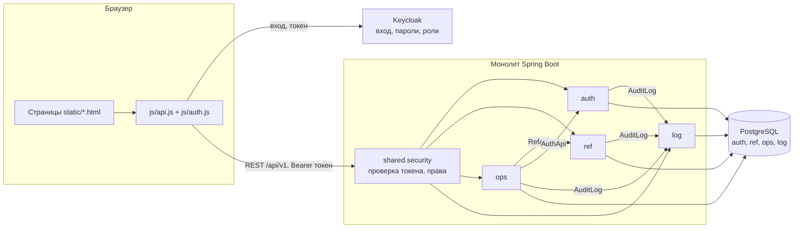
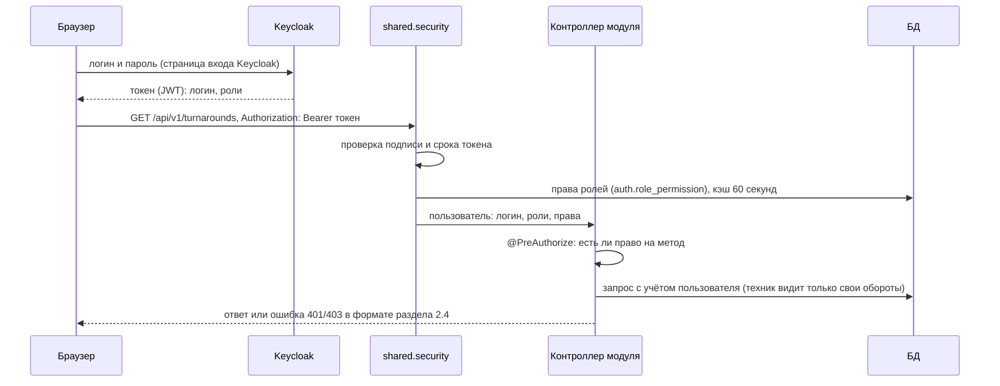

# Архитектура в коде

Этот файл описывает, как документ «Описание архитектуры» (docs/specs) переложен на код. При расхождении решения принимает группа, а потом правится и документ, и код.

## Схема



## Модули

| Пакет | Модуль | Команда | Схема | Открыт другим модулям |
|---|---|---|---|---|
| `auth` | Авторизация | Авторизация | auth | `AuthApi`: данные пользователя по логину |
| `ref` | Справочники | Справочники | ref | `RefApi`: активность записи, нормативы типа ВС |
| `ops` | Обороты | Бизнес-логика | ops | пока ничего |
| `log` | Журнал и отчёты | Данные | log | `AuditLog`: запись журнала в текущей транзакции |
| `shared` | Общее | все | нет | ошибки, `CurrentUser`, `Rows` |

Внутри модуля:

```
ref/
  RefApi.java          открытый интерфейс
  package-info.java    описание модуля (@ApplicationModule)
  web/                 контроллеры REST (закрыто)
  internal/            сервисы и SQL (закрыто)
```

Spring Modulith считает модулем каждый пакет первого уровня. Тест `ModularityTests` падает, если модуль обращается к чужим `web` или `internal` или модули зависят друг от друга по кругу. Тест же рисует схему зависимостей в `target/spring-modulith-docs`.

## Правила границ

1. Модуль пишет только в свою схему базы.
2. В SELECT можно читать справочники `ref.*` и таблицу пользователей `auth.app_user`: это общие справочные данные, и запросы к ним с JOIN проще, чем вызовы через интерфейс. Остальные чужие данные берутся через открытый интерфейс модуля или через представление, которое модуль-владелец сделал для других (`ops.v_turnaround_progress`).
3. Транзакцию открывает сервис модуля, который принял запрос. Запись журнала делается в ней же через `AuditLog.record(...)`. Без транзакции `AuditLog` бросает ошибку, поэтому изменение без журнала не сохранится (ФТ-2).
4. Страницы обращаются к серверу только через REST API (`/api/v1`).
5. Изменение открытого интерфейса модуля согласуется с командами, которые им пользуются.

## Вход и права

На паре 23.10 спросили, как токен проходит через модули монолита. Ответ: никак, модули токена не видят.



1. Страница через keycloak-js отправляет пользователя на вход в Keycloak и получает токен. Токен живёт 5 минут, `js/auth.js` продлевает его перед запросами.
2. Каждый запрос к `/api/**` несёт токен. Spring Security (`shared.security.SecurityConfig`) проверяет подпись и срок один раз на входе.
3. `KeycloakJwtConverter` берёт из токена логин (`preferred_username`) и роли (`realm_access.roles`). Права к ролям достаёт `auth` из таблиц `auth.role` и `auth.role_permission` (кэш 60 секунд).
4. Дальше код модулей получает пользователя через `CurrentUser.get()`: логин, роли, права.
5. Право на метод проверяется аннотацией `@PreAuthorize("hasAuthority('turnarounds.create')")`. Ограничения по данным, например «техник видит только назначенные ему обороты», проверяет код модуля.

Кто что хранит (подробно в [ADR-0002](adr/0002-keycloak.md)):

| Keycloak | Наша база |
|---|---|
| учётные записи, пароли, блокировка после 5 попыток, сессии 45 минут и 12 часов | справочник прав `auth.permission` |
| роли (technician, supervisor, «Заправщик»…) и кому какие роли назначены | права ролей `auth.role_permission` |
| | ФИО пользователей `auth.app_user` для экранов и журнала |
| | заявки на изменение данных `auth.change_request` |

Профиль `dev` заменяет Keycloak фильтром `DevAuthenticationFilter`: все запросы идут от sup01, другого пользователя подставляют заголовками `X-Dev-User` и `X-Dev-Roles`. В рабочем режиме этот фильтр не подключается.

## Соглашения API

Всё из раздела 2 спецификации API:

- базовый адрес `/api/v1`, JSON, имена полей в camelCase;
- время `YYYY-MM-DDTHH:MM:SS` в местном времени базового аэропорта, без часового пояса (`LocalDateTime`);
- ошибка всегда `{ "error": { "code", "message", "details" }, "requestId" }`. Её формирует `GlobalExceptionHandler` из `ApiException` или ошибки проверки полей;
- `requestId` попадает в заголовок `X-Request-Id`, в тело ошибки и в лог сервера;
- списки возвращаются как `{ "items": [...], "total": N }`;
- автообновление страниц идёт с заголовком `X-Background: true` (не продлевает сессию, ФТ-52).

## Как добавить метод API

1. Найдите метод в спецификации API: адрес, право, параметры, ошибки, алгоритм.
2. Контроллер положите в `web` своего модуля, на метод поставьте `@PreAuthorize` с правом из таблицы 3.1.
3. Логику положите в сервис `internal`. Метод, который меняет данные, пометьте `@Transactional` и вызовите в нём `auditLog.record(...)`.
4. Ошибки предметной области бросайте как `new ApiException(HttpStatus.CONFLICT, "КОД", "текст")`.
5. Напишите тест и прогоните сценарий ПМИ.
6. Проверьте метод в Swagger: http://localhost:8080/swagger.
