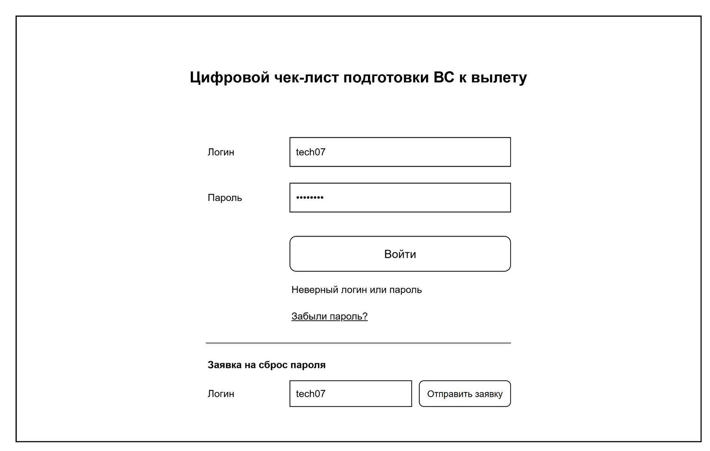
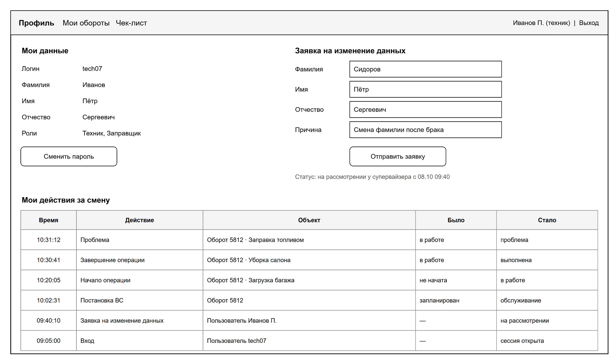
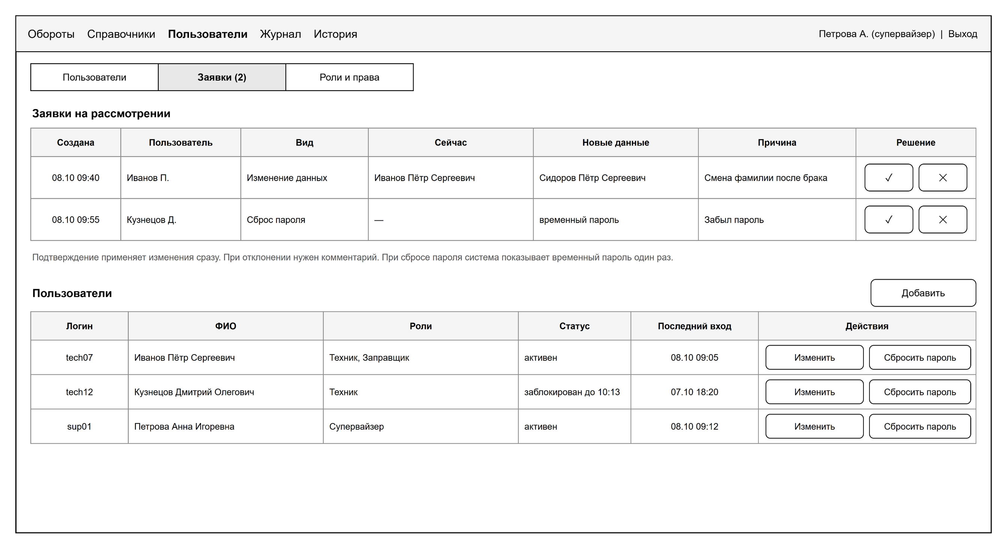
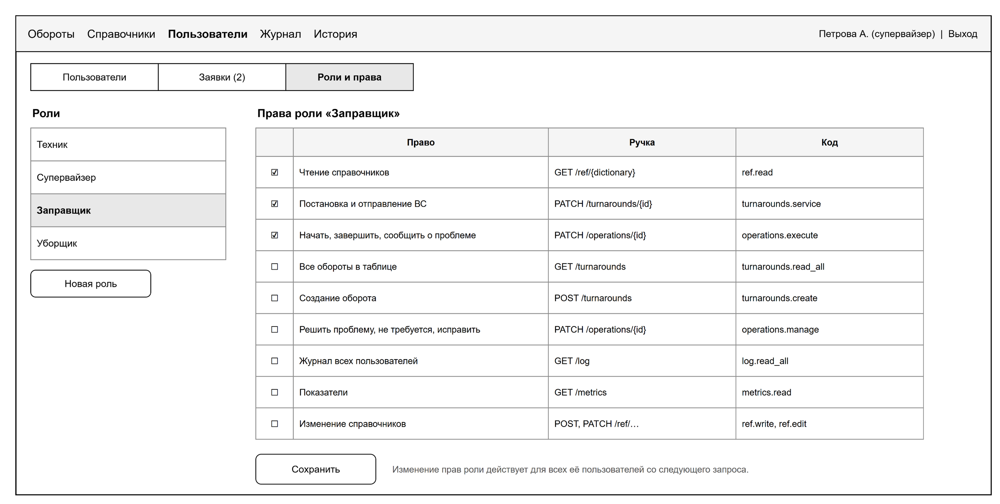

# Команда «Авторизация»

Вы отвечаете за вход в систему, учётные записи, роли и права, заявки на изменение данных. Пароли, сессии и блокировку теперь ведёт Keycloak. Ваша задача настроить его по ЧТЗ и связать с нашей базой.

## Что делаете

- Настраиваете Keycloak по ЧТЗ: блокировка на 15 минут после 5 неверных паролей, сессия 45 минут без действий и не дольше 12 часов, временный пароль при создании пользователя (ФТ-6, ФТ-7).
- Пишете методы API раздела 5 спецификации, которые остаются у нас: пользователи, роли и права, заявки. Пользователей создаёте и меняете через Admin API Keycloak.
- Делаете экраны: вход (тема страницы Keycloak в стиле дизайн-системы), профиль, «Пользователи и заявки», «Роли и права».
- Отвечаете за проверку токена и прав для всего сервера (`shared/security`).
- Правите документы под Keycloak, подробности в `docs/adr/0002-keycloak.md`: спецификация API (раздел 5), модель данных (поля пароля, таблица сессий), ПМИ (сценарии 1–8).

## Где ваш код

Пути от корня репозитория. `java/` значит `src/main/java/ru/miit/uvp411/checklist/`, `static/` значит `src/main/resources/static/`.

| Что | Где |
|---|---|
| Сервер | `java/auth/` |
| Проверка токена и прав | `java/shared/security/` (меняете вы, остальные смотрят пулреквест) |
| Страницы | `static/profile.html`, `static/users/` |
| Keycloak | `infra/keycloak/realm-checklist.json` |
| Миграции | `src/main/resources/db/migration/V<дата>__auth_<что>.sql` |

## Что уже есть

- Realm `checklist`: роли technician и supervisor, пользователи sup01, sup02, tech07, tech12 с паролем `Demo-2026`.
- Проверка токена, права ролей из `auth.role_permission`, `CurrentUser.get()`.
- `GET /api/v1/me`, страница профиля (только просмотр).
- `AuthApi.findUser(login)`: ФИО пользователя для других модулей.

## Методы API

| Метод | Что с ним | Спецификация | Сценарии ПМИ |
|---|---|---|---|
| `POST /auth/login` | вход переходит на страницу Keycloak | 5.1 | 1–4 |
| `POST /auth/logout` | выход через Keycloak | 5.2 | 6 |
| `POST /auth/password-reset` | заявка на сброс пароля без входа | 5.3 | 16 |
| `GET /me` | готово | 5.4 | |
| `PATCH /me/password` | смена пароля на странице Keycloak | 5.5 | 7 |
| `POST /me/requests` | заявка на изменение ФИО | 5.6 | 13 |
| `GET /users`, `POST /users`, `PATCH /users/{id}` | через Admin API Keycloak, копия ФИО в `auth.app_user` | 5.7–5.9 | 5, 7, 8 |
| `GET /change-requests`, `PATCH /change-requests/{id}` | решение супервайзера применяется в Keycloak | 5.10, 5.11 | 14–16 |
| `GET /roles`, `POST /roles`, `PATCH /roles/{id}`, `GET /permissions` | роль в Keycloak, права в `auth.role_permission`, после изменения сбросить кэш прав | 5.12–5.15 | 9–12 |

## План по неделям

| К паре | Что готово | Сценарии |
|---|---|---|
| 30.10 | роли в команде; у каждого поднято окружение; вход sup01 и tech07 через Keycloak в браузере; решение по ADR-0002 | 1, 2 |
| 06.11 | Keycloak настроен по ЧТЗ; спецификация, модель данных и ПМИ поправлены под Keycloak | 3, 4, 6 |
| 13.11 | методы пользователей, копия ФИО в `auth.app_user`; вкладка «Пользователи» | 5, 7, 8 |
| 20.11 | роли и права: методы и вкладка; заявки: методы, вкладка «Заявки», блок заявки в профиле | 9–16 |
| 27.11 | тема страницы входа; счётчик заявок в шапке | |
| 04.12–18.12 | исправления по замечаниям, прогон своих сценариев на стенде | 1–16 |

## Что вы даёте другим

- `CurrentUser.get()` и проверку прав: всем командам.
- Коды прав из таблицы 3.1 спецификации. Если команде нужно новое право, она пишет вам, вы добавляете его миграцией.
- `AuthApi.findUser(login)`: ФИО для журнала и чек-листа.
- `GET /users?role=technician`: список техников для экрана «Создание оборота» («Бизнес-логика»).
- `GET /users`: список для фильтра журнала («Данные»).

## Что берёте у других

- От «Данных» `AuditLog.record(...)`. Каждое изменение пишется в журнал с кодами `user_created`, `user_changed`, `role_created`, `role_changed`, `request_created`, `request_reviewed`.
- События входа из Keycloak в журнал (`login`, `login_failed`, `logout`, `account_locked`, ФТ-40) уже сделали «Данные»: в realm включены события и служебный клиент `checklist-log`, сервер забирает события раз в 30 секунд (`log/internal/KeycloakEventImporter`). При правке `realm-checklist.json` не удаляйте их.
- Дизайн-систему от «Данных».
- Блок «Мои действия за смену» в `profile.html` уже сделали «Данные». При переделке профиля оставьте его, он строится функцией `logRows()` из `/js/journal.js`.
- `GET /users?size=100` нужен «Данным» для фильтра «Пользователь» в журнале: поля `id`, `login`, `shortName`.

## Как проверять без других команд

- Keycloak поднимается вместе с базой: `docker compose -f infra/docker-compose.yml --env-file .env up -d`. Консоль администратора: http://localhost:8180/admin, вход admin / admin.
- Токен для Postman выдаёт клиент `checklist-tools`, команда есть в README репозитория.
- Остальные команды работают в профиле `dev` без Keycloak, поэтому ваши изменения в Keycloak им не мешают.

## Готово, когда

- сценарии ПМИ 1–16 проходят на стенде;
- спецификация API, модель данных и ПМИ соответствуют работе через Keycloak.

## Роли в команде

| Роль | Кто |
|---|---|
| Разработчик: сервер и Keycloak | |
| Разработчик: экраны | |
| Связь с преподавателем | |
| Данные и документы | |

## Макеты

Рисунок 1 – Вход

Рисунок 2 – Профиль

Рисунок 8 – Пользователи и заявки

Рисунок 9 – Роли и права
