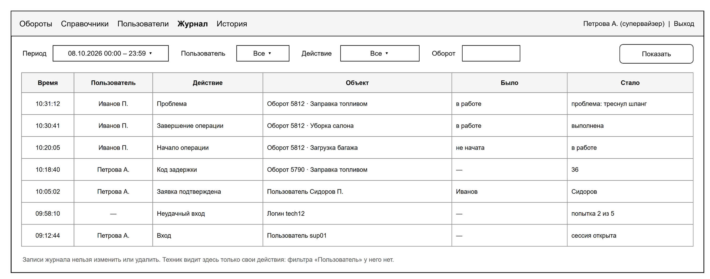
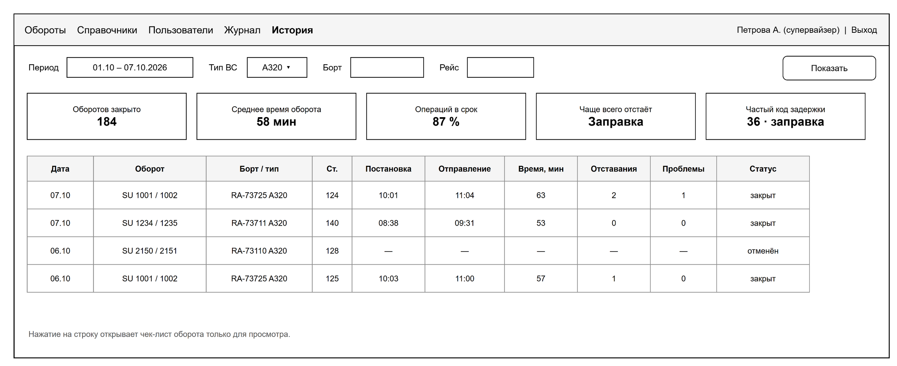

# Команда «Данные»

Вы отвечаете за журнал действий, показатели и за общие части, через которые проходят все команды: база, дизайн-система, окружение и испытания. Остальные команды ждут вашего ревью миграций и дизайна, поэтому на пулреквесты отвечаем быстро.

## Что делаете

- Журнал: запись во всех изменяющих методах всех команд, фильтры, постраничный вывод, защита записей от изменения (ФТ-2, ФТ-40–ФТ-42).
- Показатели `GET /metrics` и экраны «Журнал действий» и «История» (ФТ-43, ФТ-44).
- Дизайн-систему: витрину `/styleguide.html`, стили и общие части страниц для всех команд (окно подтверждения, вывод ошибок полей, выбор из справочника).
- Базу: ревью миграций всех команд, хранение данных 3 года, резервные копии и восстановление (ФТ-45, НФТ-4).
- Окружение: Docker, сборку в GitHub, интеграционные тесты на настоящей базе (Testcontainers), стенд в песочнице преподавателей.
- Демонстрационные данные и проверку скорости на 150 оборотах в сутки (НФТ-1, НФТ-2).
- Сводный протокол испытаний по ПМИ в конце семестра.

## Где ваш код

Пути от корня репозитория. `java/` значит `src/main/java/ru/miit/uvp411/checklist/`, `static/` значит `src/main/resources/static/`.

| Что | Где |
|---|---|
| Сервер | `java/log/`, а также `java/shared/error`, `java/shared/web`, `java/shared/jdbc` |
| Страницы | `static/log/`, `static/history/` |
| Дизайн-система | `static/css/`, `static/js/`, `static/styleguide.html`, `tools/design/` |
| База | `src/main/resources/db/migration/`: ревью всех миграций, свои называются `V<дата>__log_<что>.sql` |
| Окружение | `infra/docker-compose.yml`, `Dockerfile`, `.github/` |
| Демонстрационные данные | `tools/demo-data/` |

## Что уже есть

- `AuditLog.record(...)`: запись журнала только внутри транзакции изменения.
- `GET /api/v1/log` с фильтрами по дате, пользователю и обороту; техник видит только свои записи.
- Формат ошибок и requestId в ответе и в логе сервера.
- Дизайн-система 1.0: стили, `layout.js`, `api.js`, `format.js`, витрина `/styleguide.html` и её выгрузка одним файлом.
- Генератор демонстрационных данных, `docker-compose.yml`, `Dockerfile`, сборка в GitHub Actions.
- Простая страница журнала, заглушка «История».

## Сделано заранее (28.10)

Сделали заранее то, что не зависит от других команд. Всё проверено тестами на PostgreSQL 16 (`./mvnw verify`, 17 тестов).

| Что | Сценарии ПМИ | Где |
|---|---|---|
| `GET /log` по спецификации: период до 31 дня, фильтр по действию, страницы, имя пользователя и название объекта; техник видит только свои записи | 47, 48 | `LogController`, `LogQueries`, `LogApiTest` |
| Виды действий журнала (таблица 8.1); `AuditLog.record` с неизвестным кодом бросает ошибку | 50 | `ActionTypes` |
| Запрет `TRUNCATE` журнала вдобавок к запрету `UPDATE` и `DELETE`; тест отката изменения без журнала | 49, 50 | миграция `V202610281200`, `LogProtectionTest` |
| `GET /metrics` и представления `ops.v_turnaround_result`, `ops.v_operation_result` (проверяет «Бизнес-логика») | 51 | `MetricsController`, `MetricsQueries`, `docs/metrics.md` |
| Удаление данных старше 3 лет: процедура `log.purge_expired()`, запуск раз в месяц | 56 | `RetentionJob`, `RetentionTest` |
| Резервные копии раз в сутки, хранение 14 дней, восстановление в отдельную базу | 55 | `infra/backup`, `docs/backup.md` |
| Интеграционные тесты на PostgreSQL в Docker (Testcontainers) | | `IntegrationTest`, `TestData` |
| Экраны «Журнал действий» и «История», блок «Мои действия за смену» в профиле | 47, 48, 51 | `static/log`, `static/history`, `js/journal.js` |
| Общие части страниц для всех команд: окно подтверждения, ошибки полей, выбор из справочника, листалка | | `js/ui.js`, витрина 1.1 |
| SQL для проверок в базе на испытаниях | 49, 50, 56 | `tools/pmi` |
| Генератор демо-данных: около 2/3 операций в срок вместо 10 % | | `tools/demo-data` |

Осталось: список на экране «История» заработает, когда «Бизнес-логика» добавит фильтры в `GET /turnarounds`; фильтр «Пользователь» в журнале появится вместе с `GET /users` от «Авторизации». Ещё нужно внести новые представления и процедуру в документ «Модель данных».

## Сделано к 06.11 (замечания преподавателя 30.10)

| Что | Где |
|---|---|
| Журнал разбит на секции по месяцам: запрос за период читает только свои месяцы, старый месяц удаляется целой секцией | миграция `V202611051000`, `PartitioningTest` |
| Оценка объёма журнала: около 3 500 записей в сутки, 106 тысяч в месяц, 3,9 млн за 3 года | «Модель данных» 1.2, таблица 24 |
| Уникальность оборота: рейс только в одном неотменённом обороте, борт и стоянка только в одном обороте в работе | миграция `V202611051010`, `TurnaroundUniquenessTest` |
| Все ограничения уникальности базы собраны в одну таблицу | «Модель данных» 1.2, таблица 23 |

## Методы API

| Метод | Что с ним | Спецификация | Сценарии ПМИ |
|---|---|---|---|
| `GET /log` | добавить фильтр `actionType`, период до 31 дня, `page` и `size` | 8.1 | 47–49 |
| `GET /metrics` | закрытые обороты, среднее время оборота, доля операций в срок, частые отставания и коды задержек | 8.2 | 51 |

Другие ваши сценарии: 50 (изменение без записи в журнал откатывается), 52 (время отклика на 150 оборотах), 53 (местное время), 55 (восстановление из копии), 56 (хранение 3 года), 57 (планшет, браузеры, ПО сервера).

## План по неделям

| К паре | Что готово | Сценарии |
|---|---|---|
| 30.10 | дизайн-система показана командам и принята; репозиторий на GitHub, все приглашены, задачи заведены; роли в команде | |
| 06.11 | общие части страниц для команд; коды действий журнала согласованы со всеми; `GET /log`: действие, период, страницы | 47 |
| 13.11 | интеграционные тесты на PostgreSQL в сборке; тест отката без журнала; защита журнала от `UPDATE` и `DELETE` | 49, 50 |
| 20.11 | экран «Журнал действий» целиком; блок «Мои действия за смену» в профиле вместе с «Авторизацией» | 47, 48 |
| 27.11 | представление для показателей (проверяет «Бизнес-логика»), `GET /metrics`; генератор берёт справочники из базы | |
| 04.12 | экран «История» | 51 |
| 11.12 | хранение 3 года, резервная копия и восстановление; местное время на стенде | 53, 55, 56 |
| 18.12 | стенд в песочнице преподавателей; 150 оборотов и время отклика; проверка на планшете и в двух браузерах | 52, 57 |
| 25.12 | протокол испытаний по всем 57 сценариям | все |

## Что вы даёте другим

- `AuditLog.record(...)` и коды действий журнала (спецификация, таблица 8.1): всем командам.
- Формат ответов и ошибок: `ApiException`, `GlobalExceptionHandler`, requestId.
- Дизайн-систему и общие части страниц. Новый компонент появляется на витрине раньше, чем на экранах команд.
- Окружение, демонстрационные данные, ревью миграций.

## Что берёте у других

- От «Бизнес-логики»: поля `ops.turnaround` и `ops.operation_exec` для показателей; для «Истории» фильтры `GET /turnarounds`: `status`, `dateFrom`, `dateTo`, `aircraftTypeId`, `aircraftId`, `flightNumber`, `page`, `size` (спецификация 7.3); `GET /turnarounds/{id}` для перехода из журнала к обороту.
- От «Авторизации»: `GET /users` для фильтра журнала; решение, как события входа из Keycloak попадут в журнал.
- От «Справочников»: справочники для генератора.

## Как проверять без других команд

- Профиль `dev` и демонстрационные данные, команды есть в README репозитория.
- Журнал можно проверить сразу: любое изменение через `AuditLog.record(...)` видно в `GET /log` и в Adminer (http://localhost:8181, таблица `log.action_log`).
- Витрина дизайн-системы выгружается одним файлом командой `python tools/design/export_styleguide.py`.

## Готово, когда

- сценарии ПМИ 47–53 и 55–57 проходят на стенде;
- все команды собирают экраны из дизайн-системы и не заводят своих цветов;
- стенд работает в песочнице преподавателей, протокол испытаний заполнен.

## Роли в команде

| Роль | Кто |
|---|---|
| Разработчик: журнал и показатели | |
| Разработчик: дизайн-система и экраны | |
| Окружение и тесты | |
| Связь с преподавателем | |
| Данные и документы | |

## Макеты

Рисунок 10 – Журнал действий

Рисунок 11 – История
