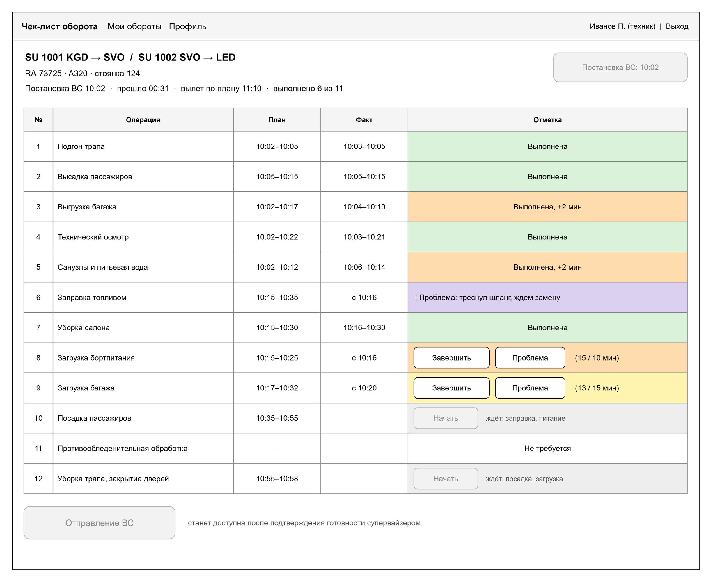
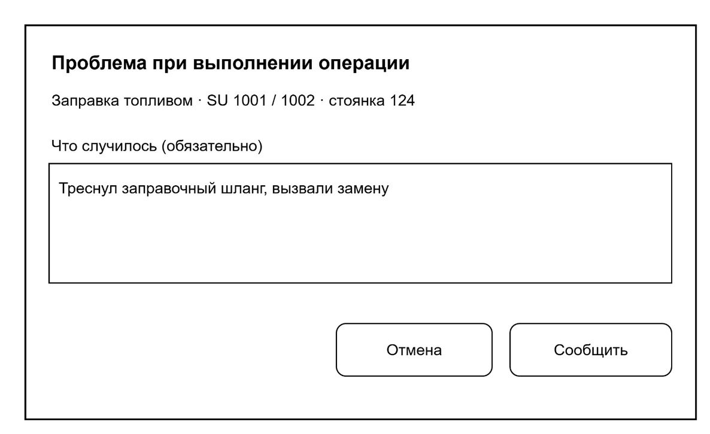
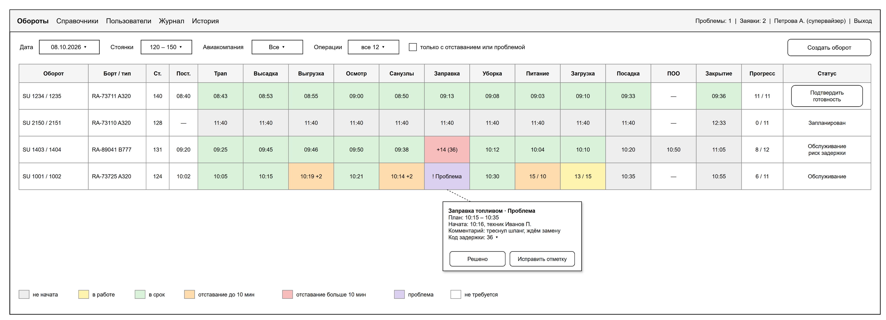
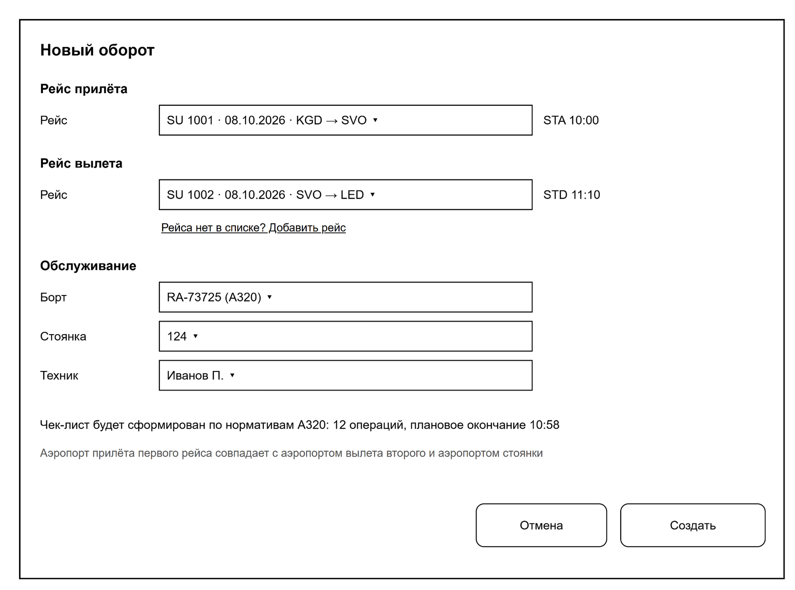

# Команда «Бизнес-логика»

Вы отвечаете за главную часть системы: рейсы, обороты, чек-лист и отметки операций. Ради ваших экранов система и делается: чек-лист техника на планшете и таблица оборотов у супервайзера.

## Что делаете

- Рейсы: поиск и создание (ФТ-23, ФТ-24).
- Создание оборота: проверки, снимок нормативов на момент создания, плановое время по цепочке зависимостей (ФТ-21, ФТ-25–ФТ-27).
- Смену статуса оборота: постановка ВС, готовность, отправление, отмена, замена техника (ФТ-28, ФТ-29, ФТ-38, ФТ-39).
- Отметки операций: начать, завершить, проблема, решено, не требуется, исправление, код задержки (ФТ-30–ФТ-37). В ответе оборота список разрешённых действий `allowedActions`, по нему экран включает кнопки.
- Экраны: «Мои обороты», чек-лист техника с окном «Проблема», таблица оборотов супервайзера, «Создание оборота».

Работы у вас больше, чем у других команд. Лучше сразу разделиться: двое на сервер, двое на экраны. Экраны можно делать параллельно с сервером: `GET /turnarounds` и `GET /turnarounds/{id}` уже отдают данные, а кнопки подключаются по мере готовности методов `PATCH`.

## Где ваш код

Пути от корня репозитория. `java/` значит `src/main/java/ru/miit/uvp411/checklist/`, `static/` значит `src/main/resources/static/`.

| Что | Где |
|---|---|
| Сервер | `java/ops/` |
| Страницы техника | `static/technician/` |
| Страницы супервайзера | `static/supervisor/` |
| Миграции | `src/main/resources/db/migration/V<дата>__ops_<что>.sql` |

## Что уже есть

- `GET /flights` и `POST /flights`: фильтры по дате, маршруту, авиакомпании и занятости; повтор ключа даёт 409 `FLIGHT_EXISTS`, создание пишет `flight_created`.
- `PlanCalculator`: рассчитывает параллельный план по зависимостям нормативов и допускает исключение необязательных операций.
- `GET /api/v1/turnarounds?date=`: техник видит только свои обороты, супервайзер все.
- `GET /api/v1/turnarounds/{id}`: оборот с чек-листом, для каждой операции план, факт, статус и предшественники.
- Представление `ops.v_turnaround_progress`: прогресс и риск задержки.
- Страницы: «Мои обороты», чек-лист (только просмотр, кнопки неактивны), простая таблица оборотов без столбцов операций, заглушка «Создание оборота».
- Демонстрационные данные: трое суток SVO, около 150 оборотов в сутки.

## Методы API

| Метод | Что с ним | Спецификация | Сценарии ПМИ |
|---|---|---|---|
| `GET /flights` | готово: date, airlineId, number, arrAirportId, depAirportId, free | 7.1 | 21 |
| `POST /flights` | готово: уникальность по шести полям ключа и журнал `flight_created` | 7.2 | 21, 22 |
| `GET /turnarounds` | готово, добавить фильтры: стоянки, авиакомпания, только с проблемами, статус | 7.3 | 43, 44 |
| `POST /turnarounds` | нормативы через `RefApi.activeNorms`, активность через `RefApi.isActive`, план по зависимостям | 7.4 | 23–26 |
| `GET /turnarounds/{id}` | готово, добавить `allowedActions` | 7.5 | |
| `PATCH /turnarounds/{id}` | переходы по диаграмме состояний оборота (ЧТЗ, рисунок А.2) | 7.6 | 27, 35–38 |
| `PATCH /operations/{id}` | переходы по рисунку А.3 ЧТЗ; ошибки `PREDECESSORS_NOT_DONE`, `DELAY_CODE_REQUIRED`, `MANDATORY_OPERATION`, `COMMENT_REQUIRED` | 7.7 | 28–33, 39–42 |

### Контракт рейса и поиска

`GET /flights` возвращает массив с полями:

| Поле | Смысл |
|---|---|
| `id` | Идентификатор рейса |
| `airline { id, iataCode }` | Авиакомпания |
| `flightNumber`, `letter` | Номер рейса и литера (пустая строка, если нет) |
| `flightDate` | Дата расписания |
| `depAirport`, `arrAirport` | IATA-коды аэропортов вылета и прилёта |
| `std`, `sta`, `atd`, `ata` | Плановые и фактические местные времена |

Фильтры:

| Параметр | Обязательный | Поведение |
|---|---|---|
| `date` | да | Дата рейса |
| `airlineId`, `number` | нет | Авиакомпания и номер |
| `arrAirportId`, `depAirportId` | нет | Аэропорт прилёта или вылета |
| `free` | нет | По умолчанию `true`: исключает рейсы, занятые неотменённым оборотом |

`POST /flights` принимает `airlineId`, `flightNumber`, `letter` (необязательно, по умолчанию пусто),
`flightDate`, `depAirportId`, `arrAirportId`, `std`, `sta`. Шесть полей ключа:
авиакомпания, номер, литера, дата и два аэропорта. Запись `flight_created` содержит `entity=flight`,
`entityId` нового рейса и переданные значения в `newValue`.

Экраны: сценарии 34 (риск задержки), 45 (подсказка), 46 (автообновление раз в 15 секунд). Плановое время проверяйте на контрольных примерах ПМИ (таблица 6).

## План по неделям

| К паре | Что готово | Сценарии |
|---|---|---|
| 30.10 | роли, разделение на сервер и экраны; окружение у каждого; разобраны контрольные примеры ПМИ | |
| 06.11 | рейсы `GET` и `POST`; расчёт планового времени с тестами на контрольных примерах; решение со «Справочниками» по стоянкам и международным рейсам | 21, 22 |
| 13.11 | `POST /turnarounds` с проверками и снимком; экран «Создание оборота» | 23–26 |
| 20.11 | `PATCH /turnarounds/{id}`; кнопки «Постановка ВС», «Отправление ВС», «Подтвердить готовность» | 27, 35–38 |
| 27.11 | `PATCH /operations/{id}`; кнопки «Начать», «Завершить», выбор кода задержки | 28–33 |
| 04.12 | проблема: окно у техника, «Решено» у супервайзера, счётчик в шапке; таблица супервайзера: столбцы операций, подсказка, карточка ячейки, фильтры, риск задержки | 34, 39–46 |
| 11.12 | все сценарии 21–46 проходят | 21–46 |
| 18.12 | исправления; проверка скорости на 150 оборотах вместе с «Данными» | 52 |

## Что вы даёте другим

- Представления оборотов для журнала и показателей. Представление для `GET /metrics` пишут «Данные», вы проверяете его как владельцы схемы `ops`.
- Фильтры `GET /turnarounds` для экрана «История» («Данные»): `status=closed,cancelled`, `dateFrom`, `dateTo`, `aircraftTypeId`, `aircraftId`, `flightNumber`, `page`, `size` (спецификация 7.3). Экран уже ждёт их и до этого показывает пометку.
- Проверить миграцию `V202611051010` с уникальностью оборота (её написали «Данные» по замечанию преподавателя). Нарушение индексов `turnaround_arr_flight_uq` и `turnaround_dep_flight_uq` в `POST /turnarounds` превращается в 409 `FLIGHT_ALREADY_USED`, нарушение `turnaround_aircraft_busy_uq` и `turnaround_stand_busy_uq` при постановке ВС в 409 `AIRCRAFT_BUSY` (спецификация 7.4).
- Проверить представления `ops.v_object_title`, `ops.v_turnaround_result`, `ops.v_operation_result` из миграции `V202610281200`: их написали «Данные» для журнала и показателей.
- Если меняете смысл полей `ops.turnaround` или `ops.operation_exec`, предупредите «Данных»: на этих полях считаются показатели.

## Что берёте у других

- От «Справочников» `RefApi`: нормативы типа ВС и проверка, что запись справочника активна.
- От «Авторизации» `AuthApi.findUser` и `GET /users?role=technician` для выбора техника.
- От «Данных» `AuditLog.record(...)` с кодами `flight_created`, `turnaround_created`, `turnaround_cancelled`, `technician_changed`, `on_block`, `ready`, `off_block`, `op_start`, `op_finish`, `op_problem`, `op_resolve`, `op_not_required`, `op_revert`, `delay_code`.
- Артёму для создания чек-листа: `PlanCalculator.calculate(LocalDateTime startAt, List<PlanCalculator.Norm> norms, Set<String> notRequiredOperations)`. `Norm` содержит `id`, `operationCode`, `seqNo`, `durationMin`, `mandatory`, `after`; результат содержит те же поля снимка и `plannedStart`/`plannedEnd`.
- От «Данных» дизайн-систему и общие части страниц: окно подтверждения, вывод ошибок полей, выбор из справочника. Цвет ячейки операции считает `operationClass()` из `static/js/format.js`.

## Как проверять без других команд

- Профиль `dev`: `./mvnw spring-boot:run -Dspring-boot.run.profiles=dev`. Запросы идут от супервайзера sup01. Чтобы работать как техник, добавьте заголовки `X-Dev-User: tech07` и `X-Dev-Roles: technician`.
- Демонстрационные данные загружаются командой из README репозитория. Ключ `--now 11:00` даёт обороты во всех статусах.
- Методы пробуйте в Swagger: http://localhost:8080/swagger.

## Готово, когда

- сценарии ПМИ 21–46 проходят на стенде;
- чек-лист работает на планшете 10 дюймов, таблица супервайзера на мониторе 1280 точек.

## Роли в команде

| Роль | Кто |
|---|---|
| Разработчик: сервер (обороты, статусы) | |
| Разработчик: сервер (рейсы, расчёт плана) | |
| Разработчик: экраны техника | |
| Разработчик: экраны супервайзера | |
| Связь с преподавателем | |
| Данные и документы | |

## Макеты

Рисунок 3 – Чек-лист техника

Рисунок 4 – Окно «Проблема»

Рисунок 5 – Таблица оборотов супервайзера

Рисунок 6 – Создание оборота
