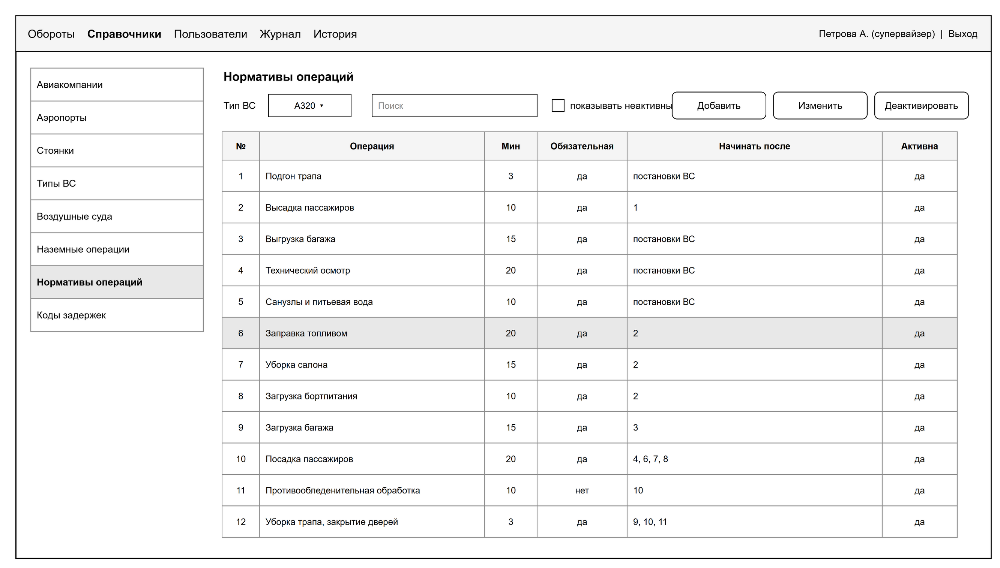

# Команда «Справочники»

Вы отвечаете за восемь справочников: аэропорты, авиакомпании, стоянки, типы ВС, борта, виды операций, нормативы операций и коды задержек. На них держится вся система: без нормативов не построится чек-лист, без бортов и стоянок не создать оборот.

## Что делаете

- Методы добавления и изменения записи с проверками: уникальный код, обязательные поля, деактивация вместо удаления, запись в журнал (ФТ-17–ФТ-19).
- Проверку цикла зависимостей в нормативах: операция не может начинаться после самой себя через цепочку (ФТ-20).
- Экран «Справочники»: список, поиск, добавление, изменение, деактивация, нормативы по типу ВС.
- Настоящие данные, как советовал преподаватель на паре 23.10:
  - аэропорты и авиакомпании берём из Википедии (коды IATA, город, страна);
  - виды наземных операций и длительности берём по открытым графикам обслуживания ВС (диаграммы Ганта), остальное дополняем здравым смыслом.
- Предложение по двум новым признакам, от которых зависит набор операций:
  - тип стоянки: контактная (телетрап) или удалённая (трап и автобусы);
  - рейс внутренний или международный.

  Предложение согласуете с «Бизнес-логикой» и преподавателем, потом правится ЧТЗ (раздел 2.2).

## Где ваш код

Пути от корня репозитория. `java/` значит `src/main/java/ru/miit/uvp411/checklist/`, `static/` значит `src/main/resources/static/`.

| Что | Где |
|---|---|
| Сервер | `java/ref/` |
| Страница | `static/ref/index.html` |
| Миграции, в том числе данные справочников | `src/main/resources/db/migration/V<дата>__ref_<что>.sql` |
| Скрипты сбора данных | `tools/ref-data/` (заведите эту папку) |

## Что уже есть

- `GET /api/v1/ref` и `GET /api/v1/ref/{dictionary}` для всех восьми справочников, с фильтром `isActive`.
- `RefApi`: `isActive(dictionary, id)` и `activeNorms(typeCode)` для других модулей.
- Начальные записи из тестовых данных ПМИ в `V1__schema.sql`.
- Страница справочников, пока только просмотр.

## Методы API

| Метод | Что с ним | Спецификация | Сценарии ПМИ |
|---|---|---|---|
| `GET /ref/{dictionary}` | готово, добавить поиск `search` | 6.1 | |
| `POST /ref/{dictionary}` | проверки, 409 `DUPLICATE_CODE`, 400 с полем в `details`, журнал | 6.2 | 17, 18 |
| `PATCH /ref/{dictionary}/{id}` | изменение и `isActive: false`, для нормативов 422 `DEPENDENCY_CYCLE` | 6.3 | 19, 20 |

Справочники в пути: `airports`, `airlines`, `stands`, `aircraft-types`, `aircraft`, `operations`, `operation-norms`, `delay-codes`. Метод один на все восемь, различаются только поля и проверки (спецификация, таблица 6.1).

Сценарий 54: новая версия справочников ставится миграцией, обороты и журнал при этом не меняются (ФТ-22).

## План по неделям

| К паре | Что готово | Сценарии |
|---|---|---|
| 30.10 | роли в команде; окружение у каждого; список источников: аэропорты, авиакомпании, графики обслуживания | |
| 06.11 | миграция с аэропортами РФ и основными зарубежными и с авиакомпаниями; предложение по типу стоянки и международному рейсу, согласованное с «Бизнес-логикой» | |
| 13.11 | `POST` и `PATCH` с проверками и журналом | 17–19 |
| 20.11 | проверка цикла; экран «Справочники» целиком; виды операций и нормативы по открытым графикам | 20 |
| 27.11 | новая версия справочников миграцией; изменения `RefApi`, если нормативы зависят от стоянки и рейса | 54 |
| 04.12–18.12 | помощь «Бизнес-логике» с экраном «Создание оборота», исправления, прогон своих сценариев | 17–20, 54 |

## Что вы даёте другим

- `RefApi.isActive` и `RefApi.activeNorms` для «Бизнес-логики»: проверки при создании оборота и снимок нормативов. Менять эти методы можно только по договорённости с ней.
- `GET /ref/...` для выпадающих списков на всех экранах.
- Справочники для генератора демонстрационных данных «Данных».

## Что берёте у других

- От «Данных» `AuditLog.record(...)` с кодами `ref_created` и `ref_changed`.
- Права `ref.read`, `ref.write`, `ref.edit` уже есть в базе.
- Дизайн-систему от «Данных». Для экрана подходят список слева (`split`, `list`) и таблица.

## Как проверять без других команд

- Профиль `dev`: `./mvnw spring-boot:run -Dspring-boot.run.profiles=dev`, вход не нужен, все запросы идут от супервайзера sup01.
- Методы удобно пробовать в Swagger: http://localhost:8080/swagger.
- Базу смотреть в Adminer: http://localhost:8181.

## Готово, когда

- сценарии ПМИ 17–20 и 54 проходят на стенде;
- в справочниках настоящие аэропорты, авиакомпании и правдоподобные нормативы;
- решение по стоянкам и международным рейсам внесено в ЧТЗ и модель данных.

## Роли в команде

| Роль | Кто |
|---|---|
| Разработчик: сервер | |
| Разработчик: экран «Справочники» | |
| Связь с преподавателем | |
| Сбор данных и документы | |

## Макеты

Рисунок 7 – Справочники
